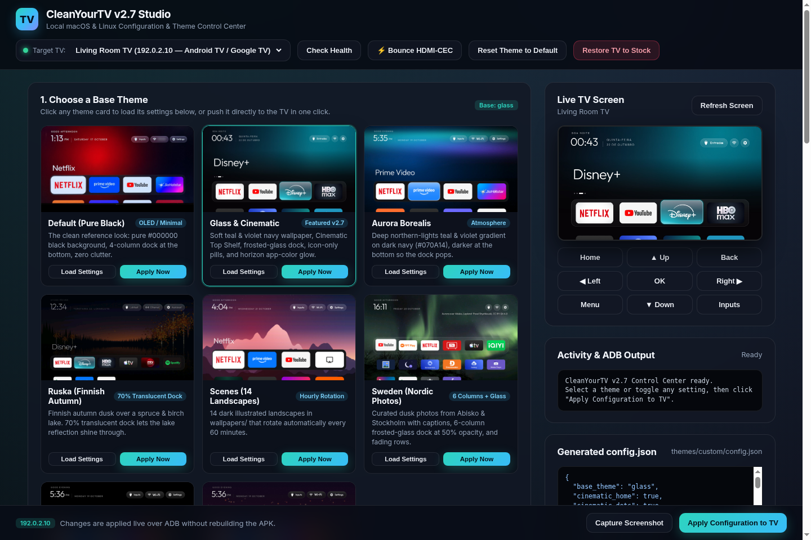

# CleanYourTV Studio

A local macOS and Linux web studio & control center (`127.0.0.1:8765`, Python 3 standard library only, zero external dependencies) for [CleanYourTV v2.7](https://github.com/Gathin23/cleanyourtv).



## Features

- **8 v2.7 Theme Presets:** Instant preview cards and 1-click live ADB deployment for `glass`, `default`, `aurora`, `ruska`, `scenes`, `sweden`, `f1`, and `f1-ferrari`.
- **Visual `config.json` Editor:** Interactive controls for all 25+ CleanYourTV v2.7 switches — Cinematic Top Shelf, Frosted Glass Dock (`dock_alpha`), Time-of-Day Sky Gradient, App Focus Glow (`glow_color`), Ambient Mode idle timeout, Clock & Greeting customization, and F1 Race Weekend countdown banner.
- **Dock & Hidden Apps Manager:** Reorder favorite dock apps (`favorite_apps`), toggle hidden packages (`hidden_apps`), and run a live ADB package scan against your TV.
- **Live TV Screen Preview & D-Pad Remote:** Capture real-time screenshots over ADB directly into the browser and navigate your TV with a built-in D-pad (Home, Back, Menu, Inputs, arrows, OK).
- **Drift Health Check & 1-Click Stock Restore:** Run `check.py` to verify disabled bloatware packages haven't drifted after an OTA update, or run `restore.sh` to return your TV to stock launcher and packages.
- **⚡ Bounce HDMI-CEC:** One-click ADB reset of `hdmi_control_enabled` / CEC handshakes when an external streamer or soundbar auto-wake / input-switching gets stuck.

## Quickstart

1. Clone [CleanYourTV](https://github.com/Gathin23/cleanyourtv) and **CleanYourTV Studio**:

```bash
git clone https://github.com/Gathin23/cleanyourtv.git
git clone https://github.com/dazdenii/cleanyourtv-studio.git
cd cleanyourtv-studio
```

2. Connect your Android TV / Google TV over network ADB (`adb connect <TV_IP>:5555`) and start the studio:

```bash
TV_HOST=<TV_IP> python3 control_center.py --repo ../cleanyourtv
```

3. Open [http://127.0.0.1:8765](http://127.0.0.1:8765) in your browser.

### CLI & Environment Options

- `--repo /path/to/cleanyourtv` (or `CLEANYOURTV_DIR` env var): Path to your local `cleanyourtv` checkout (auto-detected if placed alongside or inside the `cleanyourtv` directory).
- `--host 127.0.0.1` / `--port 8765`: Bind address and port.
- `TV_HOST`: Default TV IP address (defaults to documentation placeholder `192.0.2.10`; you can also type any `<TV_IP>` directly in the UI).
- `CLEANYOURTV_STATE_DIR`: Local directory for studio state and package backups (defaults to `~/.cleanyourtv`).

## Privacy & Security

- **100% Local:** Binds strictly to `127.0.0.1` by default, uses only the Python 3 standard library, and sends zero telemetry or external network requests.

## Tested On

- Android TV 9+ / Google TV (from macOS & Linux)

## Credits

Created by [@dazdenii](https://github.com/dazdenii) with **Grok Bot**, built on top of [@gathint](https://x.com/gathint)'s [CleanYourTV](https://github.com/Gathin23/cleanyourtv).

## License

[MIT](LICENSE)
